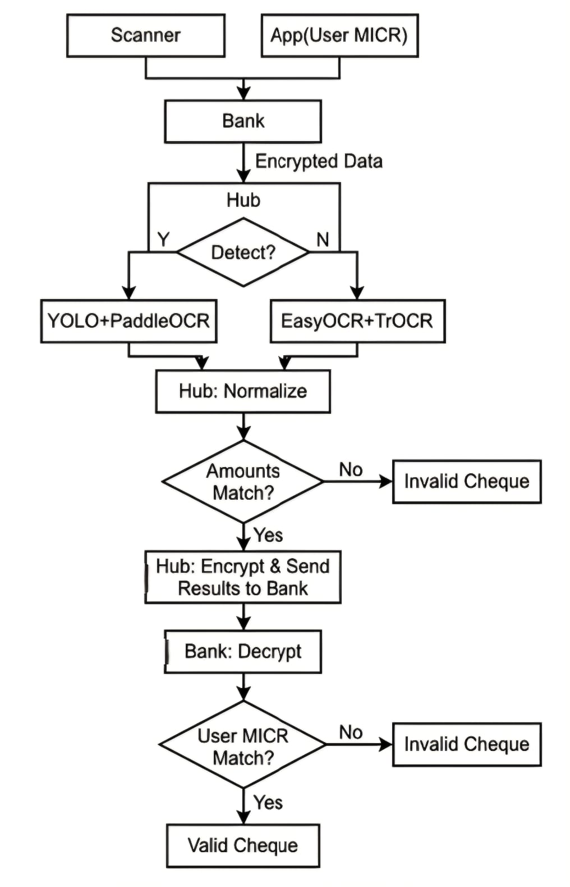
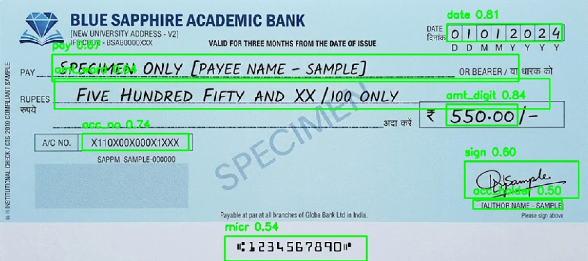

# System Architecture — Intelligent Cheque Data Extractor

This document provides a deep-dive into how the system is designed, how data flows through it, and how each component was built.

---

## Table of Contents

1. [High-Level Architecture](#1-high-level-architecture)
2. [System Flowchart](#2-system-flowchart)
3. [Pipeline Stages](#3-pipeline-stages)
4. [Component Breakdown](#4-component-breakdown)
5. [YOLO Model Design](#5-yolo-model-design)
6. [OCR Layer](#6-ocr-layer)
7. [Text Normalization Engine](#7-text-normalization-engine)
8. [Validation Logic](#8-validation-logic)
9. [Data Flow Diagram](#9-data-flow-diagram)
10. [Technology Choices & Rationale](#10-technology-choices--rationale)

---

## 1. High-Level Architecture

The system is a **multi-stage AI pipeline** that processes a raw cheque image and outputs structured, validated data. It is composed of four major AI/ML layers stacked sequentially:

```
+---------------------------------------------------------------+
|                     CHEQUE IMAGE INPUT                        |
+---------------------------------------------------------------+
                           |
                           v
+---------------------------------------------------------------+
|           LAYER 1: YOLO FIELD DETECTION                       |
|   (8 independent YOLOv8 nano models — one per cheque field)   |
+---------------------------------------------------------------+
                           | Bounding boxes + confidence scores
                           v
+---------------------------------------------------------------+
|           LAYER 2: PaddleOCR TEXT EXTRACTION                  |
|     (Run per cropped region from YOLO detection output)       |
+---------------------------------------------------------------+
                           | Raw OCR strings
                           v
+---------------------------------------------------------------+
|           LAYER 3: TEXT NORMALIZATION                         |
|     (Date parsing, numeric conversion, OCR error correction)  |
+---------------------------------------------------------------+
                           | Normalized structured data
                           v
+---------------------------------------------------------------+
|           LAYER 4: VALIDATION (Amount Cross-Check)            |
|     (Compare amount in words vs. digits; flag mismatches)     |
+---------------------------------------------------------------+
                           |
                           v
                  +-----------------+
                  |  STRUCTURED CSV  |
                  |  OUTPUT / UI     |
                  +-----------------+
```

---

## 2. System Flowchart

The flowchart below illustrates the full end-to-end processing flow including the bank integration vision, dual-OCR fallback strategy, and fraud-detection (MICR match) layer.



### Flowchart Walkthrough

| Step | Description |
|------|-------------|
| **Input** | Cheque arrives from Scanner or from App (user-provided MICR) |
| **Bank** | Passes encrypted cheque data to the Hub |
| **Hub: Detect?** | Checks if YOLO can detect the cheque fields |
| **Yes → YOLO + PaddleOCR** | High-confidence detection path for clean scans |
| **No → EasyOCR + TrOCR** | Fallback path for blurry/skewed cheques |
| **Hub: Normalize** | Text normalization runs on all OCR outputs |
| **Amounts Match?** | Cross-validates amount in digits vs. words |
| **No → Invalid Cheque** | Mismatch flags the cheque as potentially fraudulent |
| **Hub: Encrypt & Send** | Results encrypted and returned to bank |
| **Bank: Decrypt** | Bank decrypts and compares MICR |
| **User MICR Match?** | Confirms MICR band matches user-provided data |
| **Valid / Invalid** | Final cheque verdict |

---

## 3. Pipeline Stages

### Stage 1 — Image Ingestion

```python
# Accepts both file path (str) or pre-loaded numpy array
if isinstance(image_source, str):
    img = cv2.imread(image_source, cv2.IMREAD_UNCHANGED)
elif isinstance(image_source, np.ndarray):
    img = image_source

# Normalize to BGR (handles grayscale / single-channel inputs)
if len(img.shape) == 2:
    img = cv2.cvtColor(img, cv2.COLOR_GRAY2BGR)
```

Supported formats: `.png`, `.jpg`, `.jpeg`, `.tiff`, `.bmp`, `.tif`

---

### Stage 2 — YOLO Field Detection

Each of the 8 YOLO models independently scans the full cheque image and returns bounding boxes for its assigned field. The **highest-confidence box** is selected when multiple detections exist.

```python
results = model(img, conf=0.25, verbose=False)
best_box = max(results[0].boxes, key=lambda b: float(b.conf[0]))
x1, y1, x2, y2 = map(int, best_box.xyxy[0])
```

The detected field area is then **cropped** from the original image for OCR.

---

### Stage 3 — OCR Extraction

PaddleOCR is run on the cropped region. It uses angle classification to handle rotated text (common in handwritten cheques).

```python
self.ocr = PaddleOCR(use_angle_cls=True, lang="en", show_log=False)
res = self.ocr.ocr(crop, cls=True)
text = " ".join([w[1][0] for line in res for w in line]).strip()
```

**Special case — Signature field:**
The signature model only checks for *presence*, not text content. If detected → `"Yes"`, else → `"No"`.

---

### Stage 4 — Text Normalization

Three normalization functions handle the most error-prone fields:

| Field | Normalizer | Challenge |
|-------|-----------|-----------|
| `date` | `normalize_date()` | Handles `20-Sep-2025`, `20092025`, `2209202` |
| `amt_digit` | `normalize_amount_numeric()` | OCR misreads: `s->5`, `O->0`, `l->1` |
| `amt_word` | `normalize_amount_in_words()` | Converts "Five Hundred Fifty" → `550.0` |

---

### Stage 5 — Validation

The Streamlit app compares the numeric amounts from both fields:

```python
val_digit = float(data.get("Amount in Digit", "0"))
val_word  = float(data.get("Amount in Word", "0"))
data['Match'] = "Yes" if val_digit == val_word and val_digit > 0 else "No"
```

---

## 4. Component Breakdown

### `extractor.py` — Core Engine

The `ChequeExtractor` class is the heart of the system.

| Method | Purpose |
|--------|---------|
| `__init__()` | Sets models directory, confidence threshold |
| `_load_models()` | Scans `Models/` directory, loads all `.pt` files + PaddleOCR |
| `process_image()` | Runs the full pipeline; returns `(data_dict, annotated_img)` |

---

### `app.py` — Streamlit Web Interface

- Lazy-loads the `ChequeExtractor` via `@st.cache_resource` (avoids re-loading on every interaction)
- Shows a **live-updating table** as each image is processed
- Saves final results to a CSV at the source folder path

---

### `micr.py` — MICR Specialist

`MICRExtractor` is a standalone extractor focused on the MICR band at the bottom of a cheque.

**Fallback strategy**: If YOLO fails to detect the MICR region, it crops the bottom 15% of the image:

```python
y1 = int(h * 0.85)
crop = img[y1:h, 0:w]
```

---

### `text_normalizer.py` — Smart NLP Layer

#### OCR Error Correction Map

```python
OCR_DIGIT_MAP = {
    's': '5', 'b': '8', 'o': '0', 'l': '1',
    'I': '1', 'z': '2', 'g': '9', 'y': '4'
}
```

#### Fuzzy Matching for Amount in Words

Uses Python's `difflib.get_close_matches()` to handle OCR misspellings like `"thousend"` → `thousand`, `"fouvty"` → `forty`.

#### Date Parser Logic

The normalizer handles 4 distinct date formats:
1. `8-digit numeric` — `20092025` → `20-09-2025`
2. `7-digit numeric` — `2092025` → `20-09-2025` (heuristic inference)
3. `Named month` — `20-Sep-2025` → `20-09-2025`
4. `Separator-based` — `20/09/25` → `20-09-2025`

---

### `labeller.py` / `labeller2.py` — Dataset Annotation Tools

These scripts were used during the **training data preparation** phase. They provide an interactive OpenCV window to:
- Draw bounding boxes over cheque fields
- Save YOLO-format label files (normalized `[class x_center y_center width height]`)

---

## 5. YOLO Model Design

### Model Architecture

All 8 models use **YOLOv8 Nano (YOLOv8n)** — the smallest and fastest variant of YOLOv8. This choice was made for:
- Low inference latency (suitable for real-time bank processing)
- Small model size (~6 MB per model)
- Sufficient capacity for single-class detection (each model detects only 1 field)

### Training Strategy — One Model Per Field

Rather than a single multi-class model detecting all fields at once, **8 separate single-class models** were trained. This design choice offers:

| Advantage | Explanation |
|-----------|------------|
| **Simpler labeling** | Each annotator only labels one field type |
| **Independent tuning** | Each model has its own confidence threshold |
| **Better accuracy** | Single-class models are harder to confuse |
| **Easier retraining** | Update one model without affecting others |

### Fields Detected

| Model File | Detects | mAP@0.5 |
|-----------|---------|---------|
| `pay.pt` | Payee Name region | 0.984 |
| `amt_word.pt` | Amount in Words region | 0.991 |
| `amt_digit.pt` | Amount in Digits region | 0.970 |
| `date.pt` | Date field | 0.984 |
| `acc_holder.pt` | Account Holder Name | 0.919 |
| `acc_no.pt` | Account Number | 0.990 |
| `sign.pt` | Signature region | 0.876 |
| `micr.pt` | MICR band | 0.961 |

### Sample Detection Output

The image below shows all YOLO models running simultaneously on a specimen cheque, with confidence scores for each detected field:



---

## 6. OCR Layer

### PaddleOCR Configuration

```python
PaddleOCR(
    use_angle_cls=True,   # Handles rotated/tilted text
    lang="en",            # English cheques
    show_log=False        # Suppress verbose output
)
```

### Why PaddleOCR?

| Reason | Detail |
|--------|--------|
| **Open-source & free** | No API costs for offline bank processing |
| **Angle classification** | Handles tilted handwriting on cheques |
| **Strong English support** | Pretrained on large English corpora |
| **Numpy array input** | Directly accepts OpenCV crops |

### Fallback OCR (EasyOCR + TrOCR)

As shown in the flowchart, the system was designed with a **fallback OCR path** (EasyOCR + TrOCR) for cases where YOLO detection fails. This handles poor-quality scans where field boundaries cannot be reliably detected.

---

## 7. Text Normalization Engine

### Amount in Words → Number Conversion

The conversion uses a **two-pass algorithm**:

**Pass 1 — Tokenization & Fuzzy Correction**
```
"Five Hunderd Fifty only"
  → clean:  "five hunderd fifty"
  → fuzzy:  "five hundred fifty"
  → tokens: [5, "hundred", 50]
```

**Pass 2 — Accumulator Computation**
```
current_val = 0, final_val = 0
  → 5         → current_val = 5
  → "hundred" → current_val = 5 * 100 = 500
  → 50        → current_val = 500 + 50 = 550
  → final_val = 550
Output: 550.0
```

Handles: hundreds, thousands, lakhs, crores, millions, billions.

---

## 8. Validation Logic

The amount cross-check is the key **fraud detection signal**:

```
Amount in Digits: "550.00"            → 550.0
Amount in Words:  "Five Hundred Fifty" → 550.0
Match: YES → Passes validation

Amount in Digits: "5500"              → 5500.0
Amount in Words:  "Five Hundred Fifty" → 550.0
Match: NO  → Flagged as invalid (potential tampering)
```

---

## 9. Data Flow Diagram

```
Cheque Image
     |
     +---> acc_holder.pt --> OCR --> normalize --> "Account Holder Name"
     +---> acc_no.pt     --> OCR ----------------> "Account Number"
     +---> amt_word.pt   --> OCR --> normalize --> 550.0  ----+
     +---> amt_digit.pt  --> OCR --> normalize --> 550.0  ----+--> Match? --> CSV
     +---> date.pt       --> OCR --> normalize --> "20-09-2025"
     +---> pay.pt        --> OCR ----------------> "Pay Name"
     +---> sign.pt       -----------------------> "Yes" / "No"
     +---> micr.pt       --> OCR ----------------> "1234567890"
```

---

## 10. Technology Choices & Rationale

| Technology | Role | Why Chosen |
|-----------|------|-----------|
| **YOLOv8n** | Field detection | Fast, accurate, small footprint |
| **PaddleOCR** | Text recognition | Free, supports angle correction |
| **OpenCV** | Image I/O, cropping, annotation | Industry standard for CV pipelines |
| **Streamlit** | Web UI | Rapid prototyping; no frontend code needed |
| **Python `difflib`** | Fuzzy word matching | Stdlib — no extra dependency |
| **Pandas** | CSV export | Standard tabular data format |
| **PyTorch** | YOLO model backend | Required by Ultralytics |

---

*For model performance metrics and precision-recall analysis, see [MODEL_PERFORMANCE.md](MODEL_PERFORMANCE.md).*
