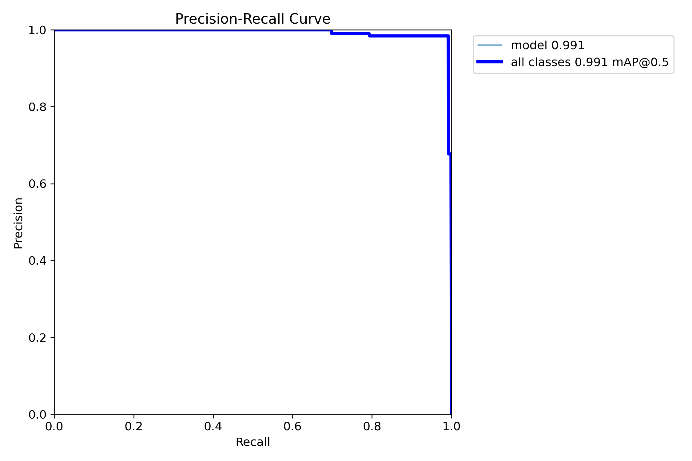
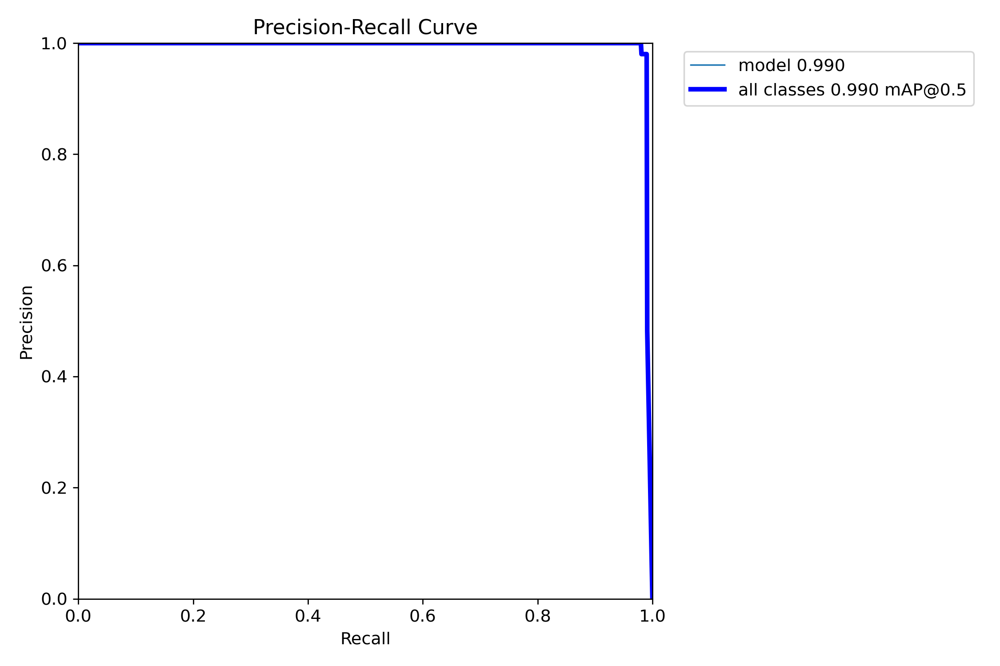
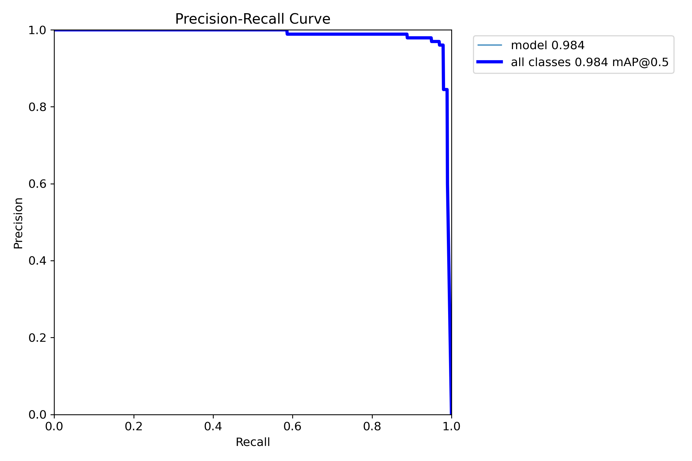
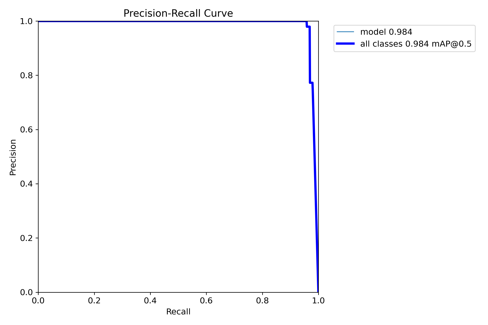
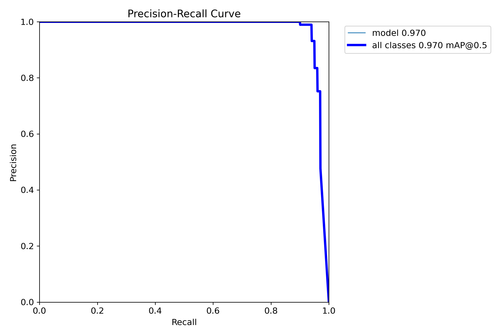
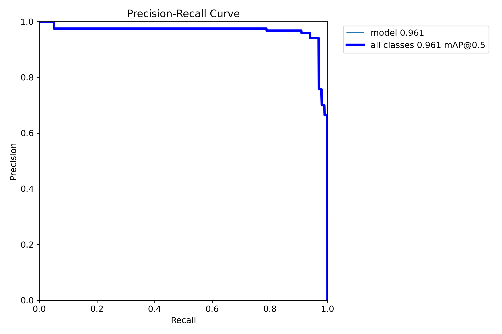
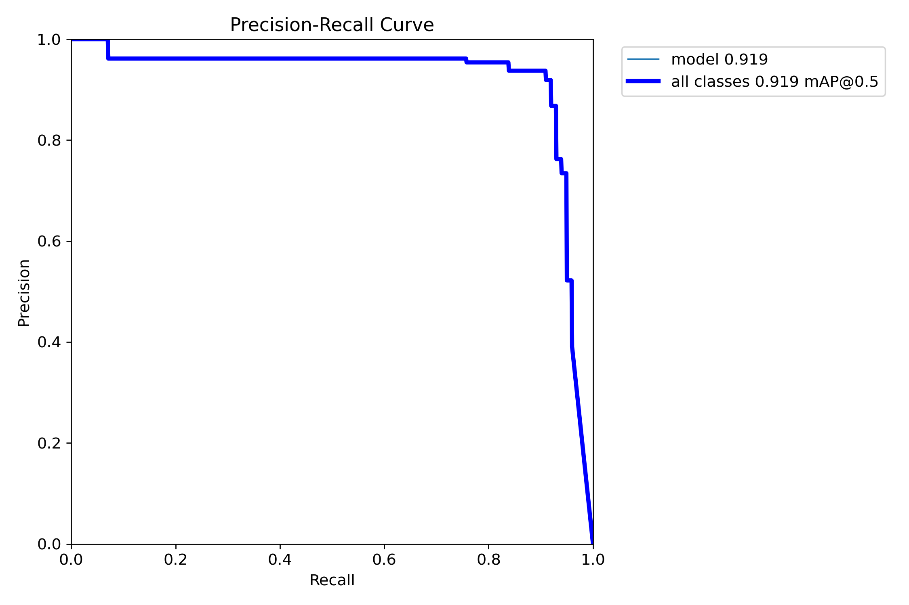
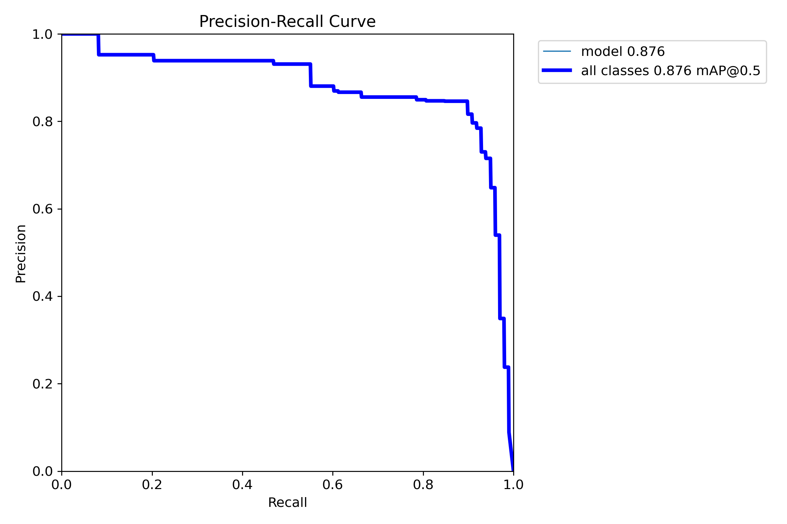

# Model Performance — YOLOv8 Precision-Recall Analysis

This document presents the training evaluation results for all 8 YOLOv8 models used in the Intelligent Cheque Data Extractor pipeline. Each model was trained independently as a single-class detector for one specific cheque field.

---

## Summary Table

| Model | Field Detected | mAP@0.5 | Rating |
|-------|---------------|---------|--------|
| `amt_word.pt` | Amount in Words | **0.991** | Excellent |
| `acc_no.pt` | Account Number | **0.990** | Excellent |
| `pay.pt` | Payee Name | **0.984** | Excellent |
| `date.pt` | Date Field | **0.984** | Excellent |
| `amt_digit.pt` | Amount in Digits | **0.970** | Very Good |
| `micr.pt` | MICR Band | **0.961** | Very Good |
| `acc_holder.pt` | Account Holder | **0.919** | Good |
| `sign.pt` | Signature Region | **0.876** | Good |

> **Average mAP@0.5 across all models: ~0.960**

---

## What Is Precision-Recall?

In object detection:

- **Precision** = Of all the times the model predicted a field, how often was it correct?
- **Recall** = Of all the actual field instances in the dataset, how many did the model find?
- **mAP@0.5** = Mean Average Precision at IoU threshold of 0.5 — the standard YOLO evaluation metric. A score of 1.0 is perfect; above 0.90 is considered excellent for real-world detection.

A curve that hugs the **top-right corner** of the plot indicates a model that is both precise and has high recall — this is the ideal shape.

---

## Per-Model Results

---

### 1. Amount in Words — `amt_word.pt`
**mAP@0.5: 0.991**

The amount-in-words field is a wide rectangular region and the model localizes it with near-perfect precision. The curve stays at or near 1.0 across the full recall range before dropping sharply — a hallmark of an ideal detector.

---

### 2. Account Number — `acc_no.pt`
**mAP@0.5: 0.990**

The account number field has a well-defined, consistent position across cheque layouts. The model achieves near-perfect precision even at near-full recall, reflecting the consistent visual appearance of this field.

---

### 3. Payee Name — `pay.pt`
**mAP@0.5: 0.984**

The "Pay" line (payee name) is reliably detected. Very high precision is maintained up to ~95% recall, with a slight drop-off at the highest recall thresholds.

---

### 4. Date Field — `date.pt`
**mAP@0.5: 0.984**

The date box is another consistently-positioned field. The model reaches maximum precision across 60–95% of the recall range, indicating robust detection under varying cheque styles.

---

### 5. Amount in Digits — `amt_digit.pt`
**mAP@0.5: 0.970**

Slightly lower than amount-in-words due to the more compact, varied sizing of the digit box across different cheque formats. Still very strong performance, staying near 1.0 precision up to ~90% recall.

---

### 6. MICR Band — `micr.pt`
**mAP@0.5: 0.961**

The MICR band at the bottom of the cheque is detected reliably. Some recall challenges arise from very faint or low-contrast MICR prints. The model includes a fallback (bottom-15% crop) for when YOLO confidence is low.

---

### 7. Account Holder Name — `acc_holder.pt`
**mAP@0.5: 0.919**

This field shows slightly more variability in its location across different cheque designs (some banks place it above the signature box, others below). Despite this, the model maintains high precision across a broad recall range (0.0 to ~0.9).

---

### 8. Signature Region — `sign.pt`
**mAP@0.5: 0.876**

The lowest-scoring model, which is expected — signatures vary enormously in size, style, and ink density. The curve shows good precision at moderate recall but a gradual decline as confidence thresholds are relaxed. The model's role is purely **presence detection** (Yes/No), not OCR, which reduces the downstream impact of missed detections.

---

## Interpretation & Insights

### Why These Scores Are Strong

Cheque field detection is challenging because:
- Cheque layouts vary significantly across banks
- Printed and handwritten text coexist
- Image quality ranges from high-resolution digital to low-DPI scans

An average mAP@0.5 of **~0.960** across 8 models trained on real cheque data is a strong result.

### Why Signature Has the Lowest Score

Signatures are inherently **high-variance** objects:
- No two signatures look alike
- Ink color, stroke width, and size vary widely
- Some signatories use stamps rather than handwritten signatures

The model's 0.876 mAP@0.5 is still considered **good** for this task.

### Why One Model Per Field?

Training separate models means each model only needs to learn one pattern. This:
- **Reduces class confusion** (no model needs to distinguish "date" from "amount")
- **Allows independent threshold tuning** (signature model can use lower confidence than account number)
- **Makes retraining surgical** (improve just the date model without retraining everything)

---

## Sample Detection on Real Cheque

The image below shows all 8 models running on a sample cheque. Green bounding boxes mark detected regions, and confidence scores are shown as labels:

Detected fields visible in this sample:
- `pay 0.87` — Payee name region
- `date 0.81` — Date field
- `amt_digit 0.84` — Amount in digits
- `amt_word` — Amount in words (full width)
- `acc_no 0.74` — Account number
- `sign 0.60` — Signature present
- `acc_holder 0.50` — Account holder name
- `micr 0.54` — MICR band at bottom

---

*For detailed system design and architecture, see [ARCHITECTURE.md](ARCHITECTURE.md).*
